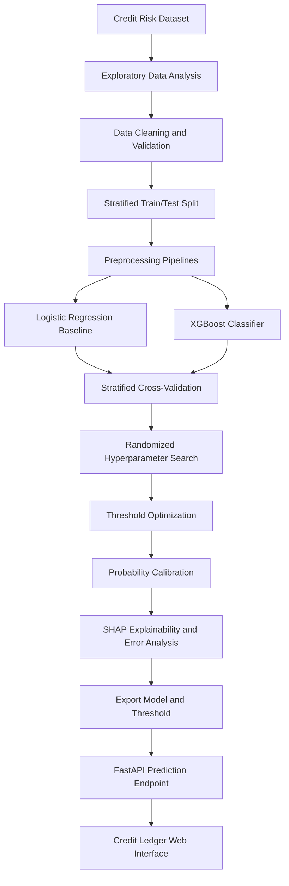

# 💳 Credit Risk Assessment | Machine Learning & FastAPI

[](https://www.python.org/)
[](https://pandas.pydata.org/)
[](https://scikit-learn.org/)
[](https://xgboost.readthedocs.io/)
[](https://fastapi.tiangolo.com/)
[](https://shap.readthedocs.io/)

A complete machine learning project that analyzes consumer loan applications, identifies applicants with a higher likelihood of default, and serves predictions through a **FastAPI backend** and a custom web interface.

---
## 🌐 Live Application

Try the deployed application here:

### [🚀 Credit Ledger — Loan Risk Assessment](https://credit-risk-ml-system-1g3x.onrender.com/)


# 🎯 Business Problem

Lenders need to assess the likelihood that a borrower will fail to repay a loan. Decisions based on limited or inconsistent checks can expose a lending portfolio to avoidable credit risk.

The objective of this project is to build a classification workflow that learns from historical loan and borrower characteristics to estimate the **probability of loan default** and classify an application as **Low Risk** or **High Risk** using a configurable decision threshold.

### Project Objectives

- Explore borrower, loan, and credit-history characteristics.
- Identify missing values, duplicate records, class imbalance, and implausible observations.
- Prepare numerical and categorical features without leaking test information into training.
- Compare Logistic Regression with XGBoost.
- Evaluate models using classification metrics and stratified cross-validation.
- Tune XGBoost hyperparameters and optimize the classification threshold.
- Calibrate predicted probabilities and interpret model behavior with SHAP.
- Examine false-positive and false-negative predictions.
- Export the trained model and threshold, then serve predictions through FastAPI.

---

# 📊 Exploratory Data Analysis

The initial analysis examines the structure, quality, and distribution of the credit-risk dataset.

### Data Overview

The notebook uses `credit_risk_dataset.csv` and reviews:

- Dataset dimensions and data types.
- Descriptive statistics for numerical variables.
- Missing values across all columns.
- The distribution of the target variable, `loan_status`.
- The distribution of previous defaults recorded in `cb_person_default_on_file`.
- Outliers and implausible values in numerical features.
- Correlations between numerical variables.

### Target Distribution and Class Imbalance

The target variable is `loan_status`. The notebook checks the count and percentage of each target class and visualizes the class distribution.

Because default cases may be less frequent than non-default cases, the project accounts for class imbalance during model development using:

- `class_weight="balanced"` for Logistic Regression.
- `scale_pos_weight` for XGBoost, calculated from the negative-to-positive class ratio in the training target.
- Stratified train/test splitting and stratified cross-validation to preserve class proportions.

### Outliers and Data Validation

Boxplots are used to inspect the numerical variables. The notebook also checks for observations with unusually high ages and employment lengths.

The cleaning stage removes:

- Duplicate records.
- Applicants younger than 18 or older than 100.
- Records where employment length exceeds the applicant's age.
- Records with employment length greater than 60 years.

**894 rows were removed in total** during duplicate removal and validation of impossible or implausible values.

---

# 🧹 Data Cleaning & Preparation

A separate copy of the original dataset is created for cleaning so that the source dataframe remains unchanged.

### Data Quality Treatment

| Step | Treatment |
|---|---|
| Duplicate records | Removed using `drop_duplicates()` |
| Applicant age | Retained ages from 18 to 100 |
| Employment length | Required to be no greater than applicant age and no greater than 60 years |
| Numerical missing values | Imputed using the median |
| Categorical missing values | Imputed using the constant value `missing` |
| Categorical encoding | One-hot encoding with unseen categories ignored |
| Numerical scaling | Standardized for Logistic Regression; not scaled for XGBoost |

### Train/Test Split

The target is separated from the feature matrix before preprocessing. The data is then split using a stratified train/test split with `random_state=42`.

Preprocessing is placed inside Scikit-learn pipelines and fitted as part of model training. This helps prevent information from the test set from influencing imputation, scaling, or categorical encoding.

---

# 🧩 Features Used

The model is trained using the following borrower, loan, and credit-history features.

### Numerical Features

```text
person_age
person_income
person_emp_length
loan_amnt
loan_int_rate
loan_percent_income
cb_person_cred_hist_length
```

### Categorical Features

```text
person_home_ownership
loan_intent
loan_grade
cb_person_default_on_file
```

### Target Variable

```text
loan_status
```

The prediction endpoint interprets class `1` as the positive/default class and returns its predicted probability as `default_probability`.

---

# ⚙️ Preprocessing Pipelines

Two separate preprocessing pipelines are created because Logistic Regression and tree-based models have different preprocessing requirements.

### Logistic Regression Pipeline

**Numerical columns**

1. Median imputation.
2. Standard scaling.

**Categorical columns**

1. Missing-value imputation using `missing`.
2. One-hot encoding with `handle_unknown="ignore"`.

### XGBoost Pipeline

**Numerical columns**

1. Median imputation.

**Categorical columns**

1. Missing-value imputation using `missing`.
2. One-hot encoding with `handle_unknown="ignore"`.

Standard scaling is not applied to XGBoost because tree-based models generally do not require numerical features to be standardized.

---

# 🤖 Model Development

Two classification algorithms are compared.

## 1. Logistic Regression — Baseline Model

Logistic Regression provides a baseline against which the more complex model can be evaluated.

The classifier is configured with:

```python
LogisticRegression(
    max_iter=1000,
    class_weight="balanced",
    random_state=42
)
```

The balanced class-weight setting increases the relative importance of the minority class during model fitting.

## 2. XGBoost Classifier

XGBoost is used to capture nonlinear relationships and interactions between borrower, loan, and credit-history characteristics.

The project first evaluates an XGBoost pipeline and then searches for a stronger configuration using randomized hyperparameter search.

### Cross-Validation Strategy

Model performance is assessed with **5-fold Stratified Cross-Validation**.

The evaluation metrics are:

| Metric | What it measures |
|---|---|
| ROC-AUC | How well the model ranks default and non-default cases across classification thresholds |
| Accuracy | Overall proportion of correct predictions |
| Precision | Proportion of predicted defaults that are actual defaults |
| Recall | Proportion of actual defaults identified by the model |
| F1-score | Harmonic mean of precision and recall |

The notebook reports the mean cross-validation score for each metric for Logistic Regression and XGBoost.

---

# 🔧 Hyperparameter Tuning

`RandomizedSearchCV` is used to search for an improved XGBoost configuration.

### Search Space

| Parameter | Search range | Purpose |
|---|---|---|
| `n_estimators` | 150–599 | Number of boosting trees |
| `max_depth` | 3–8 | Maximum depth of each tree |
| `learning_rate` | 0.01–0.06 (exclusive upper bound) | Contribution of each boosting step |
| `subsample` | 0.60–1.00 | Fraction of training rows sampled for each tree |
| `colsample_bytree` | 0.60–1.00 | Fraction of features sampled for each tree |
| `min_child_weight` | 1–9 | Minimum sum of instance weights required in a child node |
| `gamma` | 0–5 | Minimum loss reduction required to make a split |

The search is configured with:

- **200 randomized parameter combinations** (`n_iter=200`).
- **5-fold stratified cross-validation**.
- **Average Precision** as the search scoring metric.
- Parallel execution using `n_jobs=-1`.

The best estimator returned by the search is retained as `best_model_xg`.

---

# 🎚️ Classification Threshold Optimization

A classifier normally converts probabilities into class predictions using a default threshold. However, the default threshold may not provide the desired balance between identifying defaults and avoiding incorrect default flags.

This project uses the Precision-Recall curve to calculate F1-scores across candidate thresholds and selects the threshold that produces the highest F1-score.

```python
precisions, recalls, thresholds = precision_recall_curve(y_test, prob)
f1_scores = (2 * precisions * recalls) / (precisions + recalls + 1e-9)
best_index = np.argmax(f1_scores[:-1])
best_threshold = thresholds[best_index]
```

The selected threshold is then used to convert the predicted default probability into a binary prediction:

```python
prediction = int(default_probability >= best_threshold)
```

This makes the decision rule configurable rather than relying on a fixed 0.50 threshold.

> **Evaluation note:** In the supplied notebook, the threshold is selected using `y_test` and the same test set is subsequently used for evaluation. For an unbiased final performance estimate, select the threshold using a separate validation set or out-of-fold training predictions, then evaluate once on an untouched test set.

---

# 📈 Probability Calibration

A model's predicted probability is useful only when it reasonably reflects the observed frequency of the outcome. The project therefore applies **sigmoid calibration** to the tuned XGBoost estimator using `CalibratedClassifierCV` with 5-fold cross-validation.

The notebook compares:

- Uncalibrated XGBoost probabilities.
- Calibrated XGBoost probabilities.

Calibration curves are plotted against the diagonal reference line, which represents perfect calibration. This comparison helps assess whether predicted default probabilities align with observed default rates across probability bins.

---

# 🔍 Model Explainability — SHAP

SHAP (SHapley Additive exPlanations) is used to interpret how model features influence predictions.

### Global Explanation

The SHAP summary plot provides an overview of feature influence across the evaluated observations. It helps identify which borrower, loan, and credit-history characteristics contribute most to the model's predictions.

### Local Explanation

A SHAP waterfall plot is generated for an individual applicant. It illustrates how the applicant's feature values move the model output away from the baseline prediction.

These explanations make the model's behavior easier to inspect than relying on a predicted risk label alone.

---

# 🧪 False Positive & False Negative Analysis

The project compares actual and predicted target values to identify two important types of classification error.

| Error | Meaning in this project | Potential implication |
|---|---|---|
| False Positive | Model predicts default, but the applicant did not default | A potentially creditworthy applicant may be flagged as high risk |
| False Negative | Model predicts no default, but the applicant defaulted | A risky applicant may be classified as low risk |

The notebook extracts false-positive and false-negative records into separate dataframes and counts each group.

In credit-risk assessment, both error types matter. False negatives can expose a lender to losses, while false positives can result in rejecting or escalating applicants who may have repaid their loans. The acceptable balance depends on the lender's risk appetite and decision policy.

---

# 💾 Model Export

The trained XGBoost pipeline and selected classification threshold are saved separately using Joblib.

```python
joblib.dump(best_model_xg, "credit_risk_model.pkl")
joblib.dump(best_threshold, "best_threshold.pkl")
```

The exported pipeline contains its preprocessing steps as well as the classifier, so incoming application data can be passed to the pipeline in its original column format.

---

# 🌐 FastAPI Deployment

A FastAPI application loads the saved model and threshold when the application starts. The lifespan context manager stores both objects in a shared dictionary and clears it during shutdown.

### Prediction Endpoint

```text
POST /predict
```

The request body is validated with a Pydantic `LoanApplication` model.

### Input Fields

The endpoint accepts the same 11 input features used during model training:

- Applicant age and annual income.
- Home ownership and employment length.
- Loan purpose and loan grade.
- Loan amount, interest rate, and loan-to-income ratio.
- Previous default indicator and credit-history length.

### Prediction Process

1. Receive and validate the loan application.
2. Convert the input into a one-row Pandas dataframe.
3. Generate the probability of class `1` using `predict_proba()`.
4. Compare the probability with the saved threshold.
5. Return the probability, binary prediction, threshold, and risk label.

### API Response

The endpoint returns the following structure:

```json
{
  "default_probability": 0.73,
  "default_prediction": 1,
  "threshold": 0.42,
  "Result": "High Risk"
}
```

*The values above are illustrative response-format examples, not measured results from the trained model.*

---

# 🖥️ Credit Ledger — Web Interface

The project includes a custom frontend titled **Credit Ledger — Loan Risk Assessment**. It is served as static content by FastAPI from the `static/` directory.

### Applicant Interface

The form is organized into three sections:

**01 — Applicant**
- Age
- Annual income
- Home ownership
- Employment length

**02 — Loan Request**
- Loan purpose
- Loan grade
- Loan amount
- Interest rate
- Loan as a percentage of income

**03 — Credit Bureau File**
- Prior default on file
- Credit-history length

The loan-to-income ratio is automatically calculated from loan amount and annual income, while remaining editable in the interface.

### Prediction Experience

After submission, the JavaScript frontend sends the application to `POST /predict` and displays:

- Default probability in a circular gauge.
- The model's decision threshold.
- A **HIGH RISK** or **LOW RISK** visual stamp.
- The model verdict and probability details.
- API service status and request error messages.

The interface uses a dark navy palette with brass accents, a ledger-inspired layout, and responsive styling for smaller screens.

> The displayed risk category is a model output for analytical reference. It is not, by itself, a formal lending decision.

---

# 🛠️ Tech Stack

### Programming & Data Analysis

- Python
- Pandas
- NumPy
- Matplotlib
- Seaborn
- SciPy

### Machine Learning

- Scikit-learn
- XGBoost
- SHAP
- Imputation and feature preprocessing pipelines
- Logistic Regression
- Classification threshold optimization
- Probability calibration

### API & Deployment

- FastAPI
- Pydantic
- Uvicorn
- Joblib
- HTML
- CSS
- JavaScript

---

# 📁 Project Structure

The following structure reflects the files referenced by the notebook and deployment code. Keep the model artifacts and `static/` directory alongside the API application file.

```text
Credit-Risk-Machine-Learning/
│
├── static/
│   ├── index.html
│   ├── style.css
│   └── script.js
│
├── credit_risk_dataset.csv
├── credit_risk_model.pkl
├── best_threshold.pkl
├── notebook.ipynb
├── main.py
└── README.md
```

*Adjust filenames in this tree to match the names used in your repository. The API code shown in the project must be saved as `main.py` or the run command below should be changed accordingly.*

---

# 🚀 How to Run the Project

## 1. Clone the Repository

```bash
git clone <your-repository-url>
cd Credit-Risk-Machine-Learning
```

## 2. Create and Activate a Virtual Environment

```bash
python -m venv .venv
```

**Windows**

```bash
.venv\Scripts\activate
```

**macOS / Linux**

```bash
source .venv/bin/activate
```

## 3. Install Dependencies

```bash
pip install pandas numpy scikit-learn xgboost matplotlib seaborn scipy shap fastapi "uvicorn[standard]" joblib
```

## 4. Train and Export the Model

Run the notebook cells to perform the data analysis, preprocessing, model training, tuning, and export steps. The notebook should generate:

```text
credit_risk_model.pkl
best_threshold.pkl
```

Ensure both files are available in the project root before starting the API.

## 5. Start the FastAPI Application

If your API file is named `main.py`, run:

```bash
uvicorn main:app --reload
```

The API will be available locally at:

```text
http://127.0.0.1:8000
```

FastAPI's interactive API documentation is available at:

```text
http://127.0.0.1:8000/docs
```

Open the root URL to access the Credit Ledger frontend served from the `static/` directory.

---

# 🔄 End-to-End Workflow



---

# ⚠️ Important Implementation Notes

A few details in the supplied notebook should be checked before treating its outputs as final portfolio metrics or deploying the model in a real lending workflow:

1. **XGBoost class-weight parameter:** the standalone XGBoost pipeline in the notebook uses `scale_pos_weights`. The XGBoost parameter is singular: `scale_pos_weight`. Correct the spelling so the intended class-imbalance weighting is applied consistently.
2. **Threshold selection:** the notebook selects the best F1 threshold using the test labels, then evaluates on that same test set. Use a validation split or out-of-fold predictions to select the threshold, and keep the test set untouched for the final evaluation.
3. **SHAP model consistency:** the SHAP section extracts the classifier from `xg_model`, while the model selected after tuning is `best_model_xg`. To explain the tuned model that is exported, build the SHAP explainer from the classifier inside `best_model_xg` and transform the data with that same pipeline's preprocessor.
4. **Error-analysis threshold:** the false-positive/false-negative section uses `best_model_xg.predict()`, which applies the classifier's default threshold. Apply the selected threshold to `predict_proba()` when the goal is to analyze errors under the deployed decision rule.
5. **Threshold condition in the helper function:** use `if threshold is not None:` rather than `if threshold:` so that an explicitly supplied threshold is always honored.
6. **Calibration and deployment choice:** the notebook creates a calibrated estimator, but the API code loads `credit_risk_model.pkl`, which is saved from `best_model_xg`. Decide whether the deployed model should be calibrated; if so, export the calibrated estimator and validate its threshold against that estimator's probabilities.

These are implementation and evaluation considerations—not reported model outcomes.

---

# 🔮 Future Improvements

Potential next steps for strengthening the project include:

- Use a dedicated validation set or out-of-fold predictions for threshold selection.
- Compare ROC-AUC, Average Precision, PR-AUC, and calibration quality across candidate models.
- Tune the decision threshold around business costs for false approvals and false rejections rather than F1 alone.
- Evaluate calibration using additional metrics such as Brier score and log loss.
- Add a model monitoring plan to track changes in default rates and feature distributions.
- Add structured API logging and request validation for realistic deployment scenarios.
- Add automated tests for the prediction endpoint and preprocessing pipeline.
- Version the model artifacts and record the training configuration.
- Add a model card describing intended use, limitations, and evaluation methodology.

---

# 📌 Project Outcome

This project demonstrates an end-to-end **credit-risk classification workflow**, from initial exploratory analysis and data validation to model comparison, XGBoost tuning, probability analysis, explainability, and API deployment.

The final application brings the model into an interactive workflow: a user enters borrower and loan information, the API returns a predicted default probability, and the frontend presents the result as a threshold-based risk category.

**Model performance figures are intentionally not listed here** because no final cross-validation or test-set metric outputs were supplied with the project materials. Add the actual measured results after completing the evaluation with a leakage-free threshold-selection process.

---

# 👨‍💻 Author

## Muhammad Rohail

**Data Analyst | Machine Learning | Business Intelligence**
